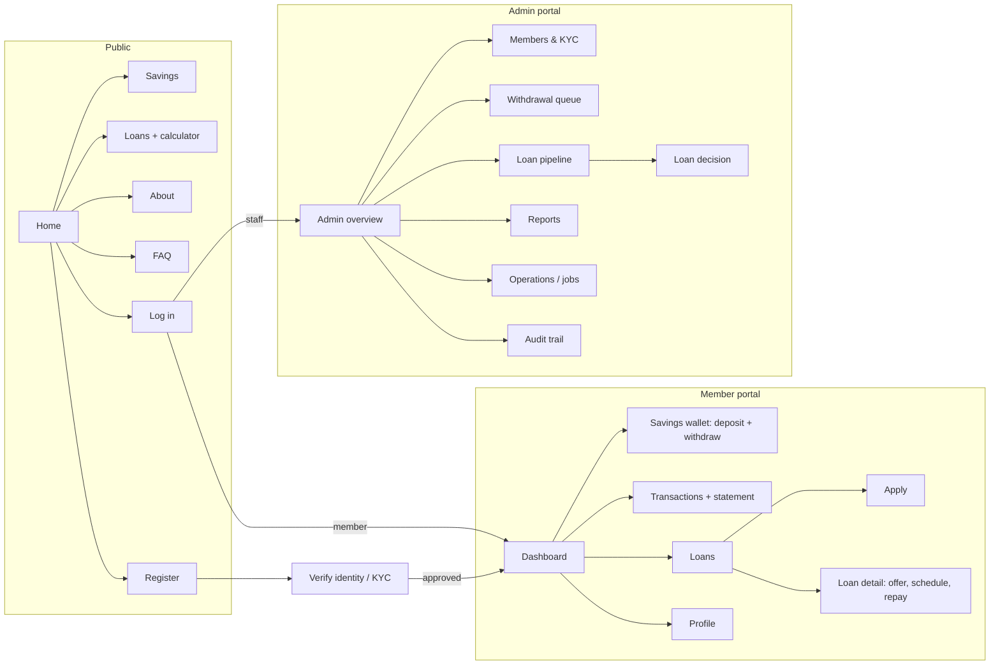
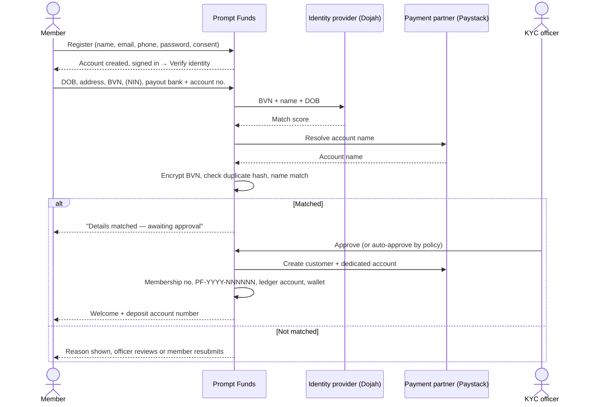
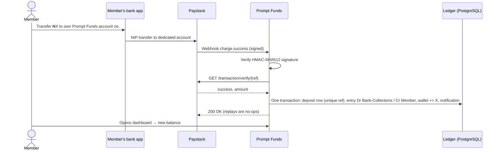
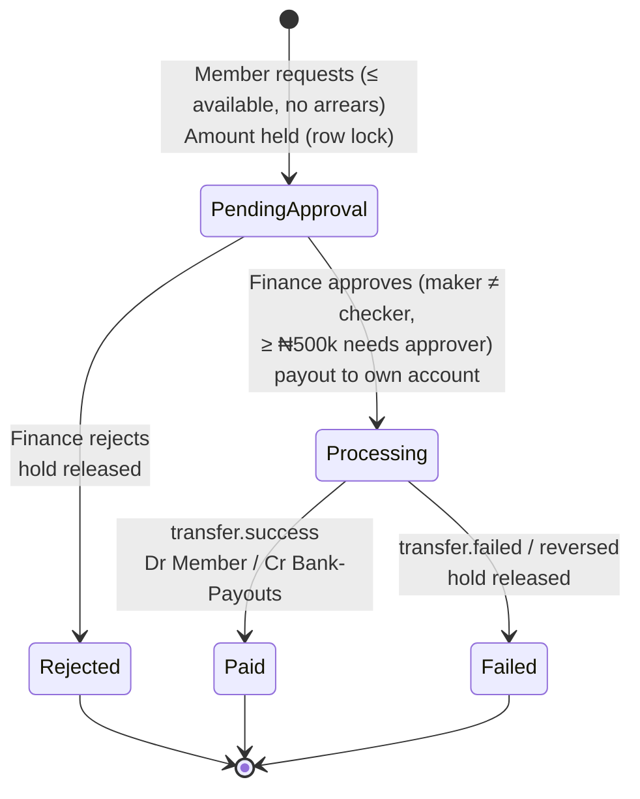
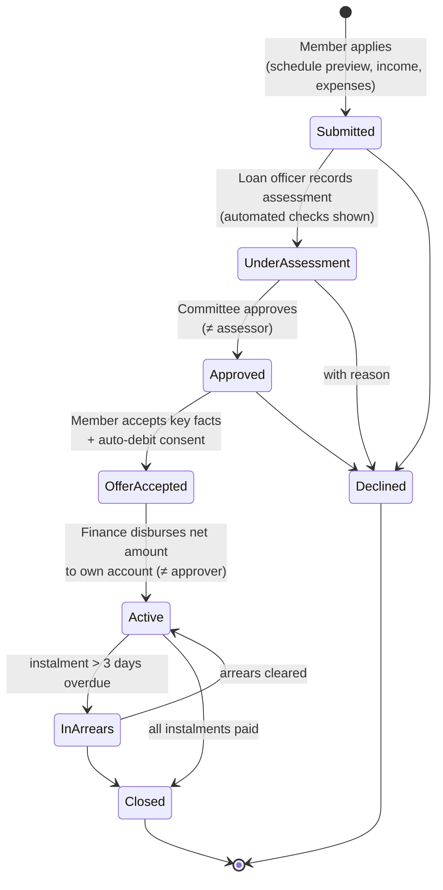
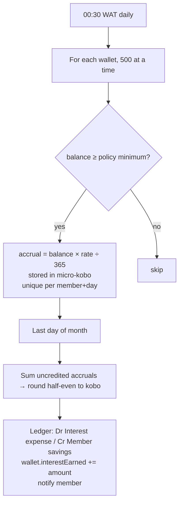
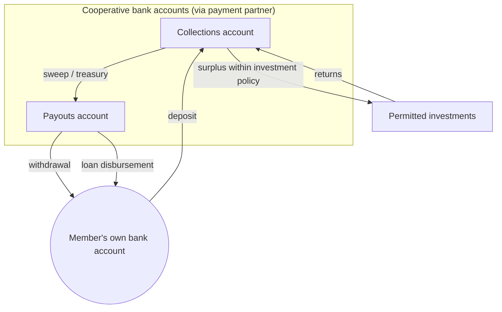

# 1. Screen map

The member portal uses a **bottom navigation bar** on phones (Home · Savings · Loans · History · Profile) and a top tab bar on larger screens. Until identity is approved, members only see the verification screen.

# 2. Journey 1 — Join and verify

**Rules:** free at every step; one membership per BVN; must be 18+; payout account must be in the member’s own name.

# 3. Journey 2 — Deposit

# 4. Journey 3 — Withdraw

Target: paid within **1 business day**. The member sees the status on the wallet page and gets a notification at each outcome.

# 5. Journey 4 — Loan

**Repayment:** any time from the loan page (from savings), and automatically each night for due instalments if savings are available. Allocation: oldest instalment first, interest before principal.

# 6. Journey 5 — Interest

# 7. Money flow between accounts

Liquidity rule: the finance team keeps enough in the payouts account to cover pending withdrawals plus expected disbursements; the admin overview shows **liquidity cover** (cash at bank ÷ member savings) and flags it red below 20%.

# 8. Staff daily routine

| Time | Who | Screen | Action |
|---|---|---|---|
| 08:00 | Finance | Overview | Check trial balance = ₦0, liquidity cover, overnight job results |
| 08:15 | Finance | Operations / Reconciliation | Resolve unreconciled deposits from the provider report |
| 09:00 – 16:00 | KYC officer | Members & KYC (queue) | Approve / reject verified applicants |
| 09:00 – 16:00 | Finance | Withdrawals | Approve & pay; escalate ≥ ₦500k to approver |
| 10:00 | Loan officer | Loans → To assess | Assess new applications |
| Weekly / as needed | Committee | Loans → Committee | Approve / decline |
| Daily | Finance | Loans → To disburse | Disburse accepted offers |
| Weekly | Collections | Loans → Arrears | Member outreach (respectful, member only) |
| Month-end | Finance / Auditor | Reports | Trial balance, income vs expense, PAR ageing, board pack |

# 9. Error and edge states

| Situation | What the member sees | What the system does |
|---|---|---|
| Deposit to an unknown account number | Nothing (not their account) | Parked in reconciliation for staff |
| Webhook delivered twice | One deposit | Unique provider reference → no-op |
| Two withdrawals tapped at once | One request | Idempotency key + wallet row lock |
| Withdrawal while in arrears | “Please clear your overdue repayment first” | Request refused |
| Payout fails at the bank | “Withdrawal not completed — money is back in your available balance” | Hold released, audit + notification |
| BVN already used | “This BVN is already linked to another membership” | Rejected before any record is changed |
| Payout account name mismatch | “An officer will contact you” | KYC stays in manual review |
| Loan disbursement transfer fails | Offer remains accepted | Reversal entry; instalments removed; finance retries |
| Session expired | Sent to log in | Server-side session check on every page |
