# 1. Design goals

1. **Trust at a glance.** Members are handing over hard-earned money. Every screen must feel calm, precise and honest — exact Naira amounts, clear statuses, no hype.
2. **Phone-first, data-light.** Most members use mid-range Android phones on mobile data. Design for a 360 px viewport first, keep pages light, and make every action reachable with one thumb.
3. **Plain language.** Write for someone who has never used a fintech app. “Available to withdraw”, not “unencumbered balance”.
4. **Show the cost before the commitment.** Loan rate, fee, monthly repayment and total repayable are visible before applying and again before accepting.
5. **Licence-honest.** Never imply bank features. No “send money” buttons, no “transfer” language for anything except deposits into one’s own wallet.

# 2. Audience

| Persona | Device & context | Needs | Design response |
|---|---|---|---|
| Amaka, 34, market trader | Android, 3G, often outdoors | Quick deposits from daily sales; small stock loans | Big balance, copyable account number, large tap targets, high contrast |
| Tunde, 27, salaried | Android/iPhone, 4G | Disciplined saving, emergency loan | Interest visibility, loan calculator, clear schedule |
| Finance officer | Laptop, office | Fast queues, accuracy, audit | Dense tables, status badges, confirm dialogs, red flags for exceptions |

# 3. Brand

**Name:** Prompt Funds — *prompt* service, *funds* you control.

**Personality:** dependable, warm, straightforward. Think a well-run cooperative office, not a casino-style fintech.

**Logo:** a rounded-square “P” monogram in Prompt Green with a small Spark amber dot (the “prompt” moment) beside the wordmark **Prompt**Funds (“Funds” in green).

## 3.1 Colour

| Token | Hex | Use |
|---|---|---|
| Ink | `#0B1B33` | Primary text, dark balance card, admin sidebar |
| Ink soft / muted | `#334155` / `#64748B` | Secondary text, labels |
| **Prompt Green** (brand) | `#0E7C66` | Primary buttons, links, active nav, positive amounts |
| Green dark / light / 50 | `#095C4C` / `#E6F4F0` / `#F3FAF8` | Hover, success backgrounds, info panels |
| **Spark** (accent) | `#F5A524` | Interest highlights, sandbox notices — used sparingly |
| Spark light | `#FEF3DC` | Notice backgrounds |
| Danger / light | `#B42318` / `#FEECEB` | Errors, overdue, rejections |
| Canvas | `#F7F8F6` | App background |

Contrast: all text/background pairs meet **WCAG AA** (4.5:1 body, 3:1 large). Colour is never the only signal — badges always carry words.

## 3.2 Typography

- Typeface: **Inter** (fallback: system UI). Free, excellent numerals.
- **Tabular numerals** everywhere amounts appear, so columns of Naira align.
- Scale (mobile → desktop): Display 36→48 / H1 24→30 / H2 18→20 / Body 15–16 / Small 13 / Caption 11–12.
- Money formatting: `₦1,250,000.00` — symbol, thousands separators, always two decimals in the portal; marketing may drop kobo.

## 3.3 Spacing, shape, elevation

- 4-px base grid; common steps 8, 12, 16, 20, 24, 32.
- Radius: inputs/buttons 14 px; cards 20 px; badges full pill.
- Elevation: one soft card shadow; no heavy drop shadows.
- Touch targets ≥ 48 × 48 px; form fields 48 px tall.

# 4. Components

| Component | Rules |
|---|---|
| **Primary button** | Green fill, white 15 px semibold, full width on mobile forms. One primary per screen section. Shows “Working…” and disables while submitting (prevents double submits). |
| **Ghost button** | White with grey border; secondary actions. |
| **Danger button** | White with red border/text; reject/decline only. |
| **Confirm step** | Native confirm for money-moving actions (withdraw, repay, accept offer, approve, disburse). |
| **Card** | White, 20 px radius, hairline border. Group one idea per card. |
| **Balance card** | Ink background, large white total, three to four sub-figures, quick actions underneath. |
| **Status badge** | Pill; green = done/positive, amber = waiting on someone, blue = in progress, red = problem, grey = closed/neutral. Always text, e.g. “Pending approval”. |
| **Flash message** | Top of page after an action; green for success, red for error, plain sentence. |
| **Empty state** | Dashed card, one-line title, one helpful next step. |
| **Tables (admin)** | Uppercase 11 px headers, 12 px row padding, key column bold, actions in last column. On mobile, tables scroll horizontally. |
| **Bottom navigation** | Five items with icon + label: Home, Savings, Loans, History, Profile; respects iPhone safe area. |
| **Loan calculator** | Sliders for amount and tenor with live figures; expandable schedule table. |
| **Progress stepper** | KYC (Account → Identity → Wallet ready) and loan (Applied → Assessment → Approved → Accepted → Disbursed → Repaid). |

# 5. Screen specifications

## 5.1 Public site
- **Home:** headline “Save what you can. Borrow when you need.”, two CTAs (Join free / See loan rates), trust ticks (₦0 registration, no minimum, live savings rate), illustrated balance card labelled “Illustration”, four-step “How it works”, embedded loan calculator, closing CTA band.
- **Savings / Loans / About / FAQ:** single-column reading width (≤ 720 px), eyebrow label, H1, short paragraphs, 2-column feature cards, clear disclosures (not NDIC-insured; members only; no transfers).
- **Register:** one card, 5 fields + consent checkbox, inline hint “Use the name on your BVN”.

## 5.2 Member portal
- **Verify identity:** stepper, status badge, DOB, address, BVN (numeric keypad, 11 digits, monospace), optional NIN, payout bank (select) + account number. Consent line referencing NDPA. After submission, a reassuring “you’re in the queue” card.
- **Dashboard:** greeting + membership number; dark balance card (Total, Available, Pending, Interest earned, Accrued this month) with Deposit / Withdraw / Get a loan; Loans card (outstanding, next repayment highlighted red if overdue); Updates card; Recent activity (credits in green with “+”).
- **Savings wallet:** four stat cards; Deposit card with bank, large monospaced account number, account name; Withdraw card showing destination account (masked) and SLA; withdrawal history table.
- **Transactions:** filter chips by type, list with date, reference, signed amount and status; date-range CSV statement download; “Older →” pagination.
- **Loans:** list of loan cards with status; **Apply** — calculator + “About you” (purpose, income, expenses) with affordability explanation; **Loan detail** — stepper, key-facts grid, offer acceptance panel, repayment panel (outstanding, due now, available savings), schedule with per-instalment status, payments list.
- **Profile:** definition list, masked BVN, payout account, explanation of how to change it safely.

## 5.3 Admin portal
- Left sidebar (ink) on desktop; horizontal scroll nav on mobile.
- **Overview:** 8 KPI tiles; tiles turn red on exceptions (liquidity < 20%, PAR > 5%, trial balance ≠ 0).
- **Members & KYC:** search box + “KYC queue only”; table with BVN match %, payout account + name-match tick; Approve / Reject (with reason) inline.
- **Withdrawals:** oldest first; “Dual approval” badge for large amounts; Approve & pay / Reject.
- **Loans:** tabbed pipeline with counts; **Loan decision** page shows application, automated checks (✓/✗ with detail), role-appropriate action, schedule, history.
- **Reports, Operations, Audit:** tables first, explanations in one line under the title.

# 6. Content style

- Second person, active voice, short sentences. “We’ll pay it to your bank account within 1 business day.”
- Name the money: always show the amount and where it goes.
- Errors say what happened and what to do: “Please clear your overdue loan repayment before withdrawing.”
- Never shame or threaten in arrears messaging. Never mention contacting family or friends.
- Avoid jargon: “interest credited” not “accrual posting”; admin screens may use accounting terms.

# 7. Accessibility and inclusion

- WCAG 2.1 AA: contrast, focus rings (2 px green), labels on every input, `role="alert"` on errors, keyboard reachable.
- Numeric keypads (`inputMode`) for amounts, BVN and account numbers.
- Respect system font scaling; layouts reflow to 200% zoom.
- Planned translations: Yoruba, Hausa, Igbo, Nigerian Pidgin (content kept in short strings to ease translation).

# 8. Performance budget

| Metric | Budget |
|---|---|
| Largest Contentful Paint (Moto G-class, 4G) | < 2.5 s |
| JS shipped on member pages | < 200 KB gzipped |
| Images | SVG for logo/icons; no stock photography on core flows |
| Fonts | One family, two weights |

# 9. Screens from the working build

The following screenshots are taken from the running application (sandbox mode, mobile and desktop viewports). They are the starting point for visual refinement in the design phase.

<h2>Member portal (mobile, 412 px)</h2>
<figure>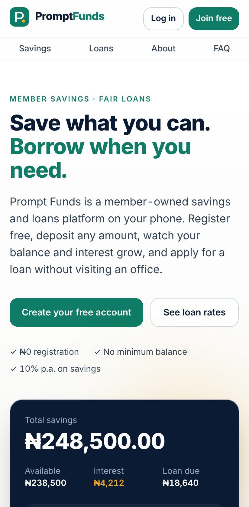<figcaption>Home (mobile)</figcaption></figure><figure>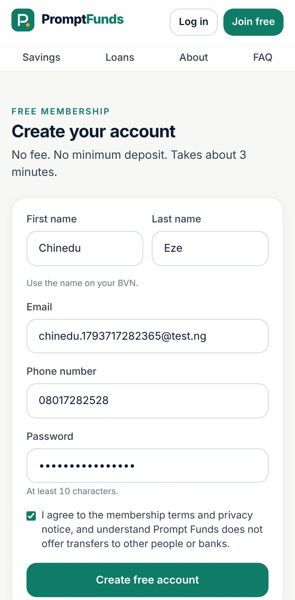<figcaption>Register</figcaption></figure><figure>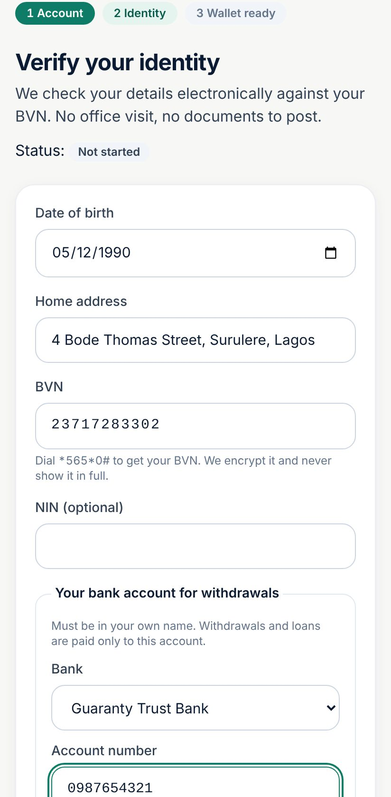<figcaption>Verify identity</figcaption></figure><figure>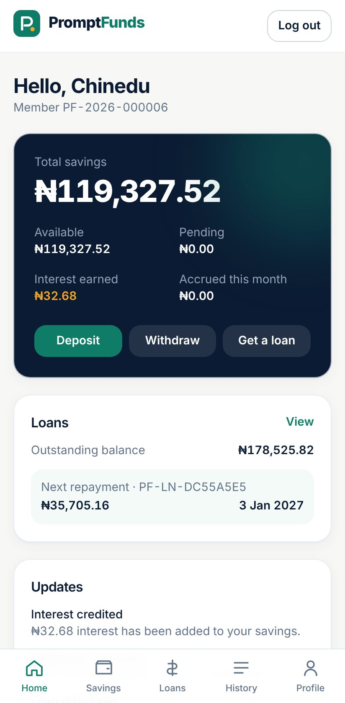<figcaption>Dashboard</figcaption></figure><figure>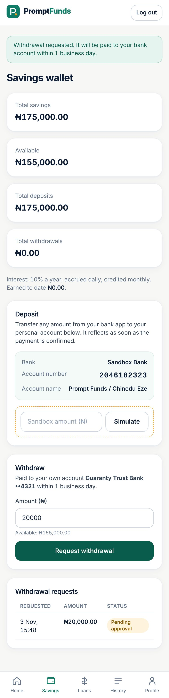<figcaption>Savings wallet</figcaption></figure><figure>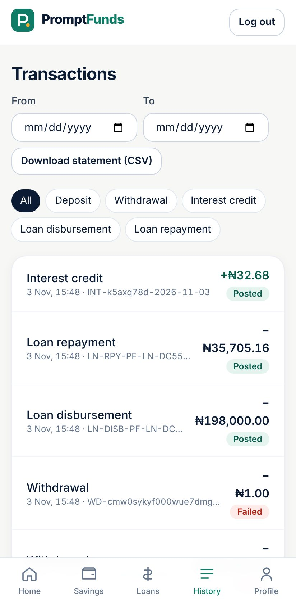<figcaption>Transactions</figcaption></figure><figure>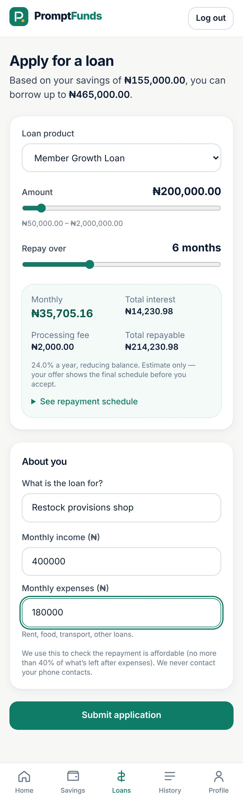<figcaption>Loan application</figcaption></figure><figure>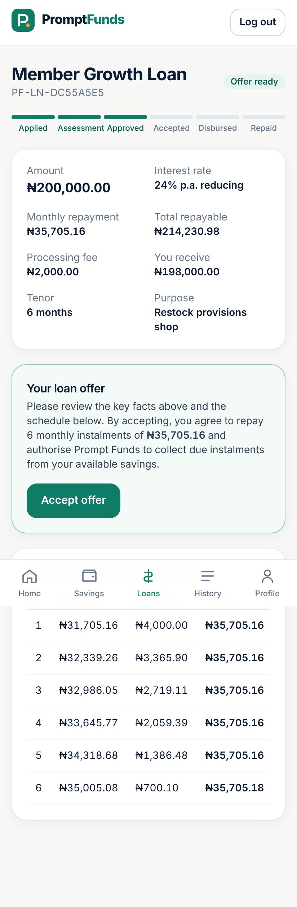<figcaption>Loan offer</figcaption></figure><figure>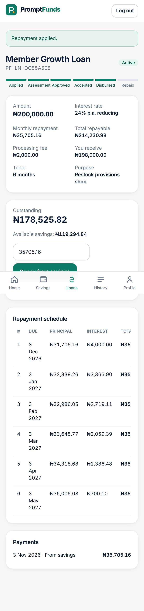<figcaption>Active loan & repayment</figcaption></figure>
<h2>Admin portal and desktop</h2><figure class="wide">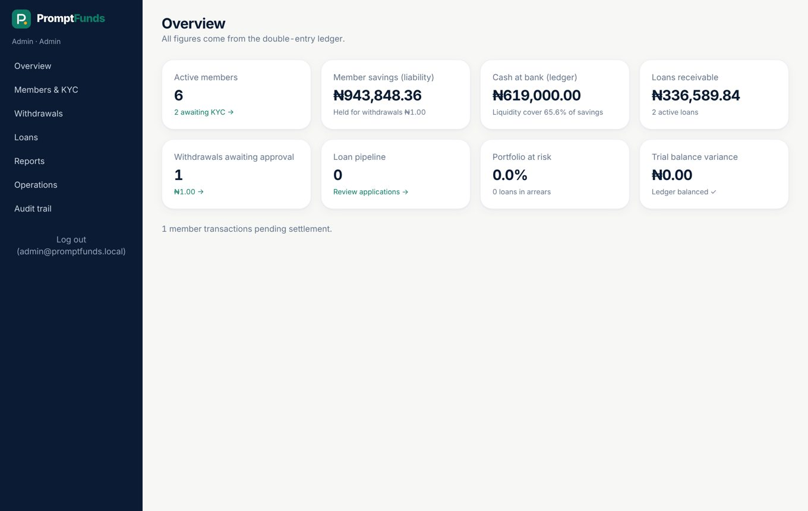<figcaption>Admin overview</figcaption></figure><figure class="wide">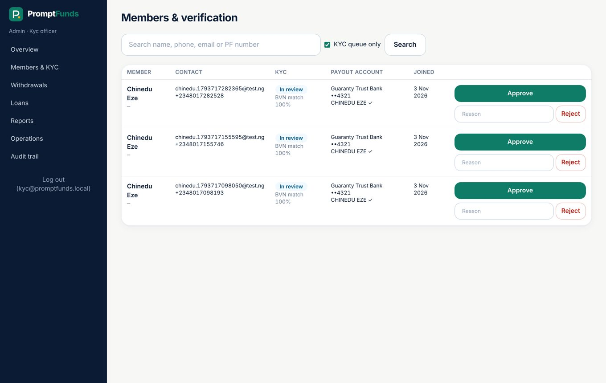<figcaption>Members & KYC queue</figcaption></figure><figure class="wide">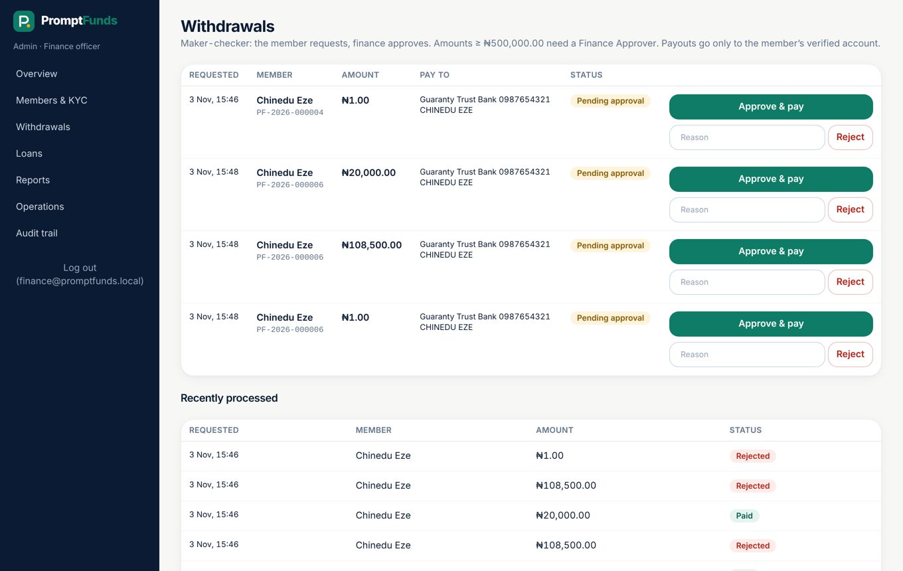<figcaption>Withdrawal queue</figcaption></figure><figure class="wide">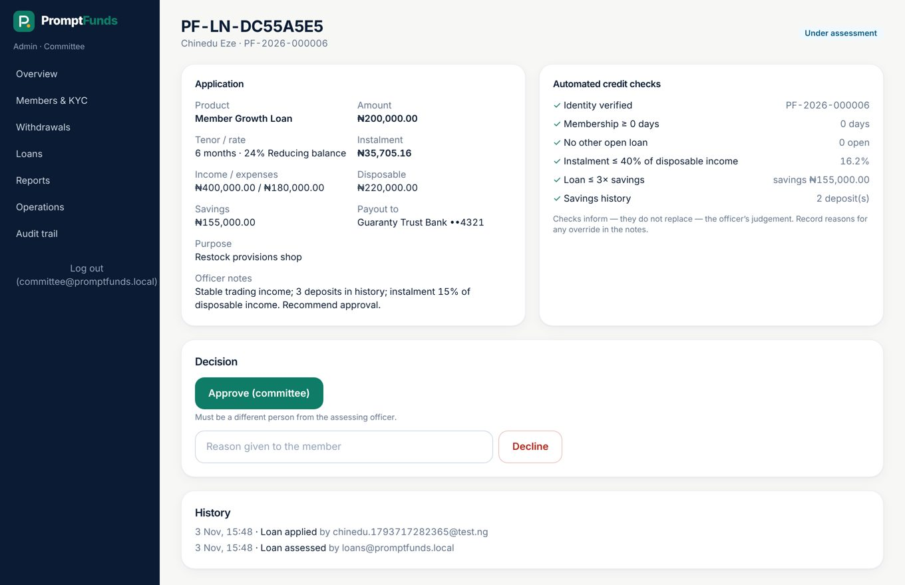<figcaption>Loan decision</figcaption></figure><figure class="wide">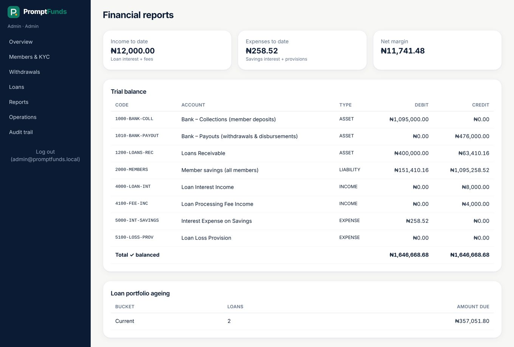<figcaption>Reports: trial balance & ageing</figcaption></figure><figure class="wide">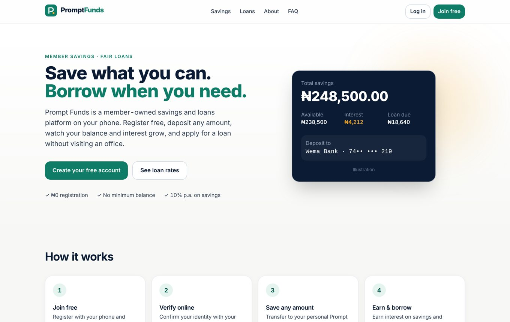<figcaption>Public home (desktop)</figcaption></figure>
