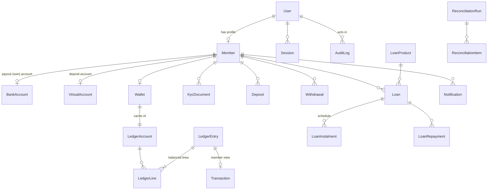

# 1. Conventions

- PostgreSQL 16. Tables and columns use Prisma’s quoted PascalCase/camelCase names (`"Member"."firstName"`).
- Primary keys are CUIDs (`text`) — non-sequential, safe to expose in URLs, no hot-spot on insert.
- **Money is `BIGINT` kobo** (₦1 = 100 kobo). Rates are integer basis points. Accruals are micro-kobo.
- Timestamps are `timestamp(3)` UTC; business dates (`accrualDate`, `dueDate`) are `date`.
- Every table that the app searches or joins on is indexed (see §4).

# 2. Entity relationship diagram



# 3. Tables

## 3.1 Identity and access

| Table | Key columns | Notes |
|---|---|---|
| **User** | id, email (unique), phone (unique), passwordHash, role, status, mfaSecret, failedLogins, lockedUntil | `role` ∈ MEMBER, KYC_OFFICER, FINANCE_OFFICER, FINANCE_APPROVER, LOAN_OFFICER, COMMITTEE, ADMIN, AUDITOR. `passwordHash` is scrypt. Index (role, status). |
| **Session** | id, userId, tokenHash (unique), ip, userAgent, expiresAt | Only the SHA-256 of the cookie token is stored. Index userId, expiresAt. |
| **OtpCode** | target, codeHash, purpose, attempts, expiresAt, usedAt | Phone/email OTP (Phase 2). |

## 3.2 Members and KYC

| Table | Key columns | Notes |
|---|---|---|
| **Member** | id, userId (unique), membershipNumber (unique, `PF-YYYY-NNNNNN`), firstName, lastName, dateOfBirth, address, bvnEncrypted, **bvnHash (unique)**, ninEncrypted, kycStatus, kycMatchScore, kycProviderRef, kycReviewedBy/At, kycRejectReason, searchText | BVN/NIN are AES-256-GCM ciphertext; `bvnHash` is HMAC-SHA256 for duplicate detection. `searchText` = lowercase name + phone + email + membership no. with a GIN trigram index. |
| **KycDocument** | memberId, type, storageKey | Object-storage key only; files never in the DB. |
| **BankAccount** | memberId (unique), bankCode, bankName, accountNumber, accountName, nameMatched, verifiedAt, recipientCode | **The only payout destination.** One per member. |
| **VirtualAccount** | memberId (unique), provider, providerCustomerRef, bankName, accountNumber (unique), accountName | Dedicated deposit account. |
| **MembershipCounter** | year (PK), value | Gap-free yearly sequence via upsert-increment inside the approval transaction. |

## 3.3 Ledger and wallet

| Table | Key columns | Notes |
|---|---|---|
| **LedgerAccount** | id, code (unique), name, type, memberId | Type ∈ ASSET, LIABILITY, INCOME, EXPENSE, EQUITY. Member sub-accounts `2000-MEMBER-<memberId>`. |
| **LedgerEntry** | id, idempotencyKey (unique), txType, reference (unique), description, postedAt, reversalOfId (unique), createdBy | Append-only (trigger). |
| **LedgerLine** | id, entryId, accountId, debit, credit | Append-only; **deferred constraint trigger** checks Σdebit = Σcredit per entry at commit. |
| **Wallet** | memberId (unique), ledgerAccountId (unique), balanceKobo, heldKobo, interestEarnedKobo, totalDepositsKobo, totalWithdrawalsKobo, version | Cache of the ledger, updated in the same transaction. CHECK `balance ≥ 0 AND held ≥ 0 AND held ≤ balance`. |
| **Transaction** | memberId, type, status, amountKobo, reference (unique), narration, entryId (unique), settledAt | Member-facing history incl. pending items. Index (memberId, createdAt DESC). |

## 3.4 Savings operations

| Table | Key columns | Notes |
|---|---|---|
| **Deposit** | memberId, providerReference (unique), amountKobo, channel, status, rawPayload, reconciledAt | Unique provider reference = webhook idempotency. |
| **Withdrawal** | memberId, amountKobo, status, idempotencyKey (unique), makerId, checkerId, approvedAt, paidAt, payoutRef (unique), failureReason | Status ∈ PENDING_APPROVAL, APPROVED, PROCESSING, PAID, REJECTED, FAILED, CANCELLED. |
| **InterestPolicy** | annualRateBps, dayCount, minBalanceKobo, effectiveFrom, approvedBy | Versioned; never updated in place. |
| **InterestAccrual** | memberId, accrualDate, balanceKobo, accruedMicroKobo, creditedEntryId | UNIQUE (memberId, accrualDate) makes daily runs idempotent. |
| **ReconciliationRun / Item** | runDate, matched, unmatched, varianceKobo / reference, providerKobo, ledgerKobo, resolved, resolvedBy, note | Daily settlement matching. |

## 3.5 Lending

| Table | Key columns | Notes |
|---|---|---|
| **LoanProduct** | name, min/maxAmountKobo, min/maxTenorMonths, annualRateBps, method, processingFeeBps, active | Method ∈ REDUCING_BALANCE, FLAT. |
| **Loan** | reference (unique, `PF-LN-XXXXXXXX`), memberId, productId, principalKobo, tenorMonths, annualRateBps, method, purpose, monthlyIncomeKobo, monthlyExpensesKobo, affordabilityBps, processingFeeKobo, totalInterestKobo, instalmentKobo, status, assessedBy, assessmentNotes, approvedBy/At, acceptedAt, disbursedBy/At, disbursementEntryId (unique), payoutRef (unique), outstandingPrincipalKobo, declineReason | Rate and method are **copied** from the product at application so later product changes never alter existing loans. |
| **LoanInstalment** | loanId, number, dueDate, principalKobo, interestKobo, paidKobo, status, daysOverdue | UNIQUE (loanId, number); index (dueDate, status) for the nightly job. |
| **LoanRepayment** | loanId, amountKobo, principalKobo, interestKobo, source, entryId (unique), paidAt | Source ∈ WALLET, AUTO_DEBIT, BANK_TRANSFER. |

## 3.6 Platform

| Table | Key columns | Notes |
|---|---|---|
| **Notification** | memberId, channel, subject, body, sentAt, readAt | In-app now; SMS/email later. |
| **Setting** | key (PK), value (JSON), updatedBy | Configurable policy values. |
| **AuditLog** | actorId, action, entityType, entityId, before, after, ip, prevHash, hash | Hash chain: `hash = SHA-256(payload + prevHash)`. Index (entityType, entityId), (actorId, createdAt), createdAt. |

# 4. Database-level integrity (SQL)

```sql
-- Ledger is append-only
CREATE TRIGGER ledger_line_immutable  BEFORE UPDATE OR DELETE ON "LedgerLine"
  FOR EACH ROW EXECUTE FUNCTION ledger_block_mutation();
CREATE TRIGGER ledger_entry_immutable BEFORE UPDATE OR DELETE ON "LedgerEntry"
  FOR EACH ROW EXECUTE FUNCTION ledger_block_mutation();

-- Every entry balances at commit time
CREATE CONSTRAINT TRIGGER ledger_line_balanced AFTER INSERT ON "LedgerLine"
  DEFERRABLE INITIALLY DEFERRED FOR EACH ROW EXECUTE FUNCTION ledger_check_balanced();

-- A wallet can never go negative or hold more than it has
ALTER TABLE "Wallet" ADD CONSTRAINT wallet_non_negative
  CHECK ("balanceKobo" >= 0 AND "heldKobo" >= 0 AND "heldKobo" <= "balanceKobo");

-- Fast fuzzy admin search
CREATE EXTENSION IF NOT EXISTS pg_trgm;
CREATE INDEX member_search_trgm   ON "Member"      USING gin ("searchText" gin_trgm_ops);
CREATE INDEX transaction_ref_trgm ON "Transaction" USING gin ("reference"  gin_trgm_ops);
```

## 4.1 Index plan (selected)

| Query | Index |
|---|---|
| Member history page, statements | Transaction (memberId, createdAt DESC) |
| Admin search | Member searchText GIN trigram |
| KYC queue | Member (kycStatus) |
| Withdrawal queue | Withdrawal (status), (memberId, requestedAt) |
| Loan pipeline | Loan (status), (memberId, status) |
| Nightly arrears | LoanInstalment (dueDate, status) |
| Member ledger balance | LedgerLine (accountId) |
| Webhook idempotency | Deposit providerReference UNIQUE, LedgerEntry idempotencyKey UNIQUE |

# 5. Key queries

```sql
-- Source-of-truth balance for one member (credit-normal liability)
SELECT COALESCE(SUM(l.credit),0) - COALESCE(SUM(l.debit),0)
FROM "LedgerLine" l JOIN "LedgerAccount" a ON a.id = l."accountId"
WHERE a.code = '2000-MEMBER-' || $1;

-- Nightly wallet-vs-ledger check (must return zero rows)
SELECT w."memberId", w."balanceKobo", SUM(l.credit) - SUM(l.debit) AS ledger
FROM "Wallet" w JOIN "LedgerLine" l ON l."accountId" = w."ledgerAccountId"
GROUP BY w."memberId", w."balanceKobo"
HAVING w."balanceKobo" <> SUM(l.credit) - SUM(l.debit);

-- Portfolio ageing (PAR buckets)
SELECT CASE WHEN "daysOverdue" = 0 THEN 'Current' WHEN "daysOverdue" <= 30 THEN '1–30'
            WHEN "daysOverdue" <= 60 THEN '31–60' WHEN "daysOverdue" <= 90 THEN '61–90' ELSE '90+' END bucket,
       COUNT(DISTINCT "loanId"), SUM("principalKobo" + "interestKobo" - "paidKobo")
FROM "LoanInstalment" WHERE status <> 'PAID' GROUP BY 1;
```

# 6. API surface

Mutations from the web UI use **server actions** (CSRF-protected by Next.js, no separate REST call). The HTTP API exists for integrations and a future mobile app.

| Method & path | Auth | Purpose |
|---|---|---|
| POST /api/auth/register | Public | Create member account, start session |
| POST /api/auth/login | Public | Email + password; lockout after 5 failures |
| POST /api/auth/logout | Session | Revoke session |
| GET /api/wallet | Member | Balances, pending items, loans, deposit account |
| GET /api/transactions?cursor=&limit= | Member | Keyset-paginated history |
| POST /api/withdrawals | Member + `Idempotency-Key` | Request withdrawal |
| GET /api/statement?from=&to= | Member | Streaming CSV statement |
| POST /api/webhooks/paystack | HMAC-SHA512 | Deposits and transfer outcomes |
| POST /api/webhooks/payments | HMAC-SHA256 | Generic/mock provider |
| POST /api/cron/{accrue\|credit\|arrears} | Bearer CRON_SECRET | Scheduled jobs |
| GET /api/health | Public | DB health check |

Errors use RFC 7807 `application/problem+json` (`title`, `status`, `detail`), and BigInt values are serialised as strings.

# 7. Data retention and privacy

| Data | Retention | Basis |
|---|---|---|
| Ledger, transactions, loans | Life of membership + 7 years | Accounting and regulatory record-keeping (confirm with counsel) |
| KYC data (encrypted) | Life of membership + 5 years | AML/KYC obligations |
| Sessions | Deleted on expiry (+30 days) | Security |
| Audit log | 7 years, append-only | Accountability |
| Raw webhook payloads | 13 months | Dispute resolution |

Members can request access and correction under the NDPA 2023; deletion requests are honoured except where records must be retained by law, in which case data is restricted.
